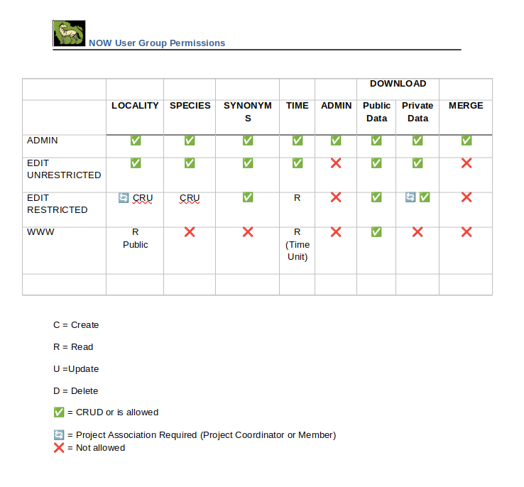

# User Rights

This document shows what each user role can and cannot do.

Previously, there were 7 different user roles:

- Admin (su)
- EditUnrestricted (eu)
- EditRestricted (er)
- Project (pl)
- ProjectPrivate (plp)
- NowOffice (no)
- ReadOnly (ro)

In the new UI platform, there are 4 user roles:

- Admin (su)
- EditUnrestricted (eu)
- EditRestricted (er, pl, plp, no)
- ReadOnly (ro)

Users who have not logged in have the **ReadOnly** role.

The Project, ProjectPrivate, and NowOffice roles exist in the old code but are currently not used. They don't exist at all in the frontend, and in the backend they are only used when assigning roles to test users.
The **EditRestricted** role is enforced in the backend for specific write operations (for example, locality writes are limited to the user's projects).

## Locality

- Any user can obtain a list of localities (private localities are an exception).
- Any user can view the details of a locality (private localities are an exception).
- Creating or updating a locality requires the **Admin**, **EditUnrestricted**, or **EditRestricted** roles.
- Deleting a locality requires the **Admin** or **EditUnrestricted** roles.

NOTE: Users with the **EditRestricted** role can update an existing locality when at least one of the projects linked to it has the user as a member. If the user removes the last project that gives them access, the save succeeds (after a confirmation warning) and the user loses edit rights to that locality. An EditRestricted user cannot unlink a project they are not a member of. Creating a locality requires all selected projects to be the user's own. Otherwise, they have reading rights only.
When creating a new locality, EditRestricted users can only select projects where they are a member.
Users with the **EditUnrestricted** role are not limited by project membership when creating or updating localities.

## Species

- Any user can get a list of species.
- Any user can view the details of a species.
- Creating or updating a species (and synonyms) requires the **Admin**, **EditUnrestricted**, or **EditRestricted** roles.
- Deleting a species requires the **Admin** or **EditUnrestricted** roles.
- Deleting a species synonym requires the **Admin**, **EditUnrestricted**, or **EditRestricted** roles.
- Merging species requires the **Admin** role (via `/admin/species-merge`).

## Occurrence (Cross-Search)

- Any user can get a list of occurrences.
- Any user can view the details of an occurrence.
- Creating or updating an occurrence requires the **Admin**, **EditUnrestricted**, or **EditRestricted** roles.
- Deleting an occurrence is not possible.

NOTE: Users with the **EditRestricted** role can only update occurrences that relate to a locality created by that user. Otherwise, they have reading rights only.

## References

- Any user can get a list of References.
- Any user can get a list of Reference types.
- Any user can view the details of a Reference.
- Creating or updating a Reference requires the **Admin**, **EditUnrestricted**, or **EditRestricted** roles.
- Deleting a Reference requires the **Admin** role.

## Time Unit

- Any user can get a list of Time Units.
- Any user can view the details of a Time Unit.
- Creating or updating a Time Unit requires the **Admin** or **EditUnrestricted** roles.
- Deleting a Time Unit requires the **Admin** or **EditUnrestricted** roles.

## Time Bound

- Any user can get a list of Time Bounds.
- Any user can view the details of a Time Bound.
- Creating or updating a Time Bound requires the **Admin** or **EditUnrestricted** roles.
- Deleting a Time Bound requires the **Admin** or **EditUnrestricted** roles.

## Region

- Viewing a list of all Regions requires the **Admin** role.
- Viewing the details of a Region requires the **Admin** role.
- Creating or updating a Region requires the **Admin** role.
- Deleting a Region requires the **Admin** role.

## Person

- Viewing a list of every person requires the **Admin** role.
- Any user can get their own information using their ID, but cannot view other people's information (unless they have the **Admin** role)
- Any user can update their own information, but cannot update anyone else's (unless they have the **Admin** role)
- Deleting a Person requires the **Admin** role.

## Project

- Logged-in users can get a list of Projects. Non-logged-in users cannot (403), and the Projects navigation link and page are hidden from them.
- Viewing project details requires the **Admin** role.
- Creating or updating a Project requires the **Admin** role.
- Deleting a Project requires the **Admin** role.

## Museum

- Logged-in users can get a list of museums and view the details of a Museum. Non-logged-in users cannot (403), and the Museums navigation link and page are hidden from them.
- Creating or updating a Museum requires the **Admin**, **EditUnrestricted**, or **EditRestricted** roles.

## Sedimentary Structure

- Any user can get a list of sedimentary structures.

## Email

- Any user can send an email

## User Rights Table

| User group       | Locality | Species | References | Time Units | Time Bounds | Regions | Persons | Projects | Museums | Sedimentary Structures | Sending Email |
| ---------------- | -------- | ------- | ---------- | ---------- | ----------- | ------- | ------- | -------- | ------- | ---------------------- | ------------- |
| Admin            | ALL      | ALL     | ALL        | ALL        | ALL         | ALL     | ALL     | ALL      | ALL     | ALL                    | C             |
| EditUnrestricted | ALL      | ALL     | ALL        | ALL        | ALL         | X       | X\*\*\* | R\*\*    | ALL     | ALL                    | C             |
| EditRestricted   | CRU      | CRU     | CRU        | R          | R           | X       | X\*\*\* | R\*\*    | CRU     | R                      | C             |
| ReadOnly         | R        | R       | R          | R          | R           | X       | X\*\*\* | R\*\*    | R       | R                      | C             |
| Not logged in    | R        | R       | R          | R          | X           | X       | X       | X        | X       | R                      | C             |

C = Create

R = Read

U = Update

D = Delete

X = No rights

ALL = All rights

\* = Requires a Project association

\*\* = Any logged-in user can view a list of projects, but viewing the details of a project requires the **Admin** role.

\*\*\* = Users can only get their information.

Below is a matrix showing the user rights. Not all of these are implemented yet.

